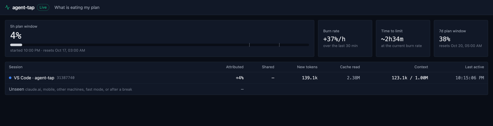
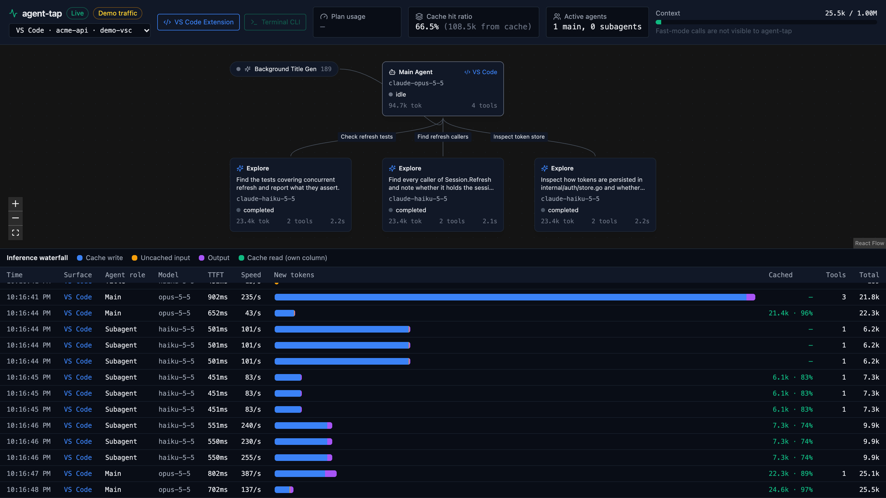

# agent-tap

**See what is eating your Claude plan limit, live.**

`atap` is a local flight recorder for Claude Code on a Pro or Max
subscription. It sits on `127.0.0.1` between Claude Code and
`api.anthropic.com`, watches every request stream by, and shows you a live
dashboard: how fast your 5-hour window is burning, which session is burning
it, how big each context has grown, and what every agent and subagent is
doing right now.

Nothing leaves your machine except the requests Claude Code was already
sending to Anthropic, unchanged.



## What you get

- **Plan burn.** Your 5h and 7d utilization as Anthropic reports it, the rate
  per hour, the projected time until you hit the limit, and each session's
  share of the rise.
- **Context weight.** Per turn: new tokens, cache writes and cache reads, so a
  session re-sending 500K cached tokens every turn is obvious.
- **Agent graph.** The main agent, its subagents and their tool calls as a
  live DAG, including parallel subagents.
- **Token waterfall and inspector.** Every request with timing, speed, model,
  stop reason and previews of what was sent and received.


- **Status line and alerts.** Plan usage in the Claude Code status line, and a
  toast at 80% and 90% of the 5h window.

## Requirements

- macOS (Apple Silicon or Intel)
- Claude Code (CLI or VS Code extension) on a Pro or Max subscription
- Claude Code v2.1.273 or later for full session and subagent detail

## Install

Download the binary for your Mac from the
[latest release](https://github.com/Revanth14/agent-tap/releases/latest):

```sh
curl -fsSL https://github.com/Revanth14/agent-tap/releases/download/v0.1.0/atap-v0.1.0-darwin-arm64.tar.gz | tar -xz
cd atap-v0.1.0-darwin-arm64
```

Use `darwin-amd64` on an Intel Mac. The binaries are not notarized. If you
download through a browser instead of `curl`, clear the quarantine flag first:
`xattr -d com.apple.quarantine ./atap`.

Or build from source (Go 1.26+, Node 20+):

```sh
git clone https://github.com/Revanth14/agent-tap.git && cd agent-tap && make build
```

The binary is `./bin/atap`, with the dashboard embedded.

## Try it without touching Claude Code

```sh
./atap start --demo
```

Open <http://127.0.0.1:9090/ui/>. Simulated sessions play every minute.
Demo data goes to its own database (`~/.agent-tap/demo.db`) and your Claude
Code settings are not changed. Plan usage stays empty in the demo: atap only
shows numbers Anthropic actually sent. Stop it with Ctrl-C.

## Wire it into Claude Code

```sh
./atap init
```

`init` does four things, in this order:

1. Copies the binary to `~/.agent-tap/bin/atap` and installs a LaunchAgent
   (`dev.agent-tap.daemon`) that keeps the daemon running across logins.
2. Waits until the daemon answers. If it never does, it removes the
   LaunchAgent and leaves your settings alone.
3. Installs the status line mod in `~/.agent-tap/mod`.
4. Backs up `~/.claude/settings.json` to `settings.json.atap.bak`, then adds
   `ANTHROPIC_BASE_URL=http://127.0.0.1:9090`, two Claude Code flags
   (`CLAUDE_CODE_GATEWAY_HINT_HEADERS`, `ENABLE_TOOL_SEARCH`), the mod
   directory, and HTTP hooks for `PreToolUse`, `PostToolUse` and
   `SubagentStop`.

New Claude Code sessions route through atap; open sessions keep their old
settings until restarted. The dashboard is at <http://127.0.0.1:9090/ui/>.

```sh
./atap status    # wiring, daemon health, what it has seen
./atap uninit    # undo everything
```

**If Claude Code stops responding after `init`,** the daemon is not running:
while `ANTHROPIC_BASE_URL` points at it, Claude Code cannot reach Anthropic.
Run `atap status`, check `~/.agent-tap/atap.log`, and run `atap uninit` to
restore your settings. `uninit` puts your settings back first, then removes
the LaunchAgent. Recorded data in `~/.agent-tap` stays until you delete it.

## Privacy and safety

- **Local only.** The daemon binds `127.0.0.1`. There is no cloud service,
  account, analytics or update check.
- **Requests are not modified.** `/v1/messages` bodies are forwarded byte for
  byte, so prompt caching behaves exactly as it does without atap. The only
  header changed is `Accept-Encoding`.
- **Credentials are never stored.** `Authorization`, `x-api-key` and `Cookie`
  are forwarded to Anthropic and never logged or written to disk.
- **Data stays on disk for 30 days.** Telemetry, including short previews of
  prompts, outputs and tool arguments, lives in `~/.agent-tap/state.db` and is
  pruned at startup after 30 days.
- **Browser hardening.** Every route checks the `Host` header (DNS
  rebinding), hooks accept JSON only (CSRF), the WebSocket is same-origin, and
  the UI ships a strict Content Security Policy.

## How it works

```
Claude Code ──/v1/messages──▶ atap (127.0.0.1:9090) ──▶ api.anthropic.com
     │                          │  tee the SSE stream, parse usage and
     └──HTTP hooks─────────────▶│  rate-limit headers, classify agents
                                ▼
                     SQLite (~/.agent-tap) ──▶ WebSocket ──▶ dashboard /ui/
```

atap identifies sessions, agents and subagents from the headers Claude Code
sends (`x-claude-code-session-id`, `-agent-id`, `-request-class`), falling back
to the request body. Plan utilization comes from the rate-limit headers on
each response. Hooks fill in tool calls and subagent completion.

## Known limitations

- macOS only for now; `init` relies on launchd.
- Plan utilization arrives in 1% steps, so the burn rate needs a few changes
  before it shows. When several sessions run at once, their shares of a rise
  are approximate, and usage from other machines shows as unattributed.
- Updating the binary with `atap init` restarts the daemon, which can cut off
  a response that is streaming at that moment.
- Opening the inspector does not refit the agent graph.

## License

[Apache-2.0](LICENSE)
